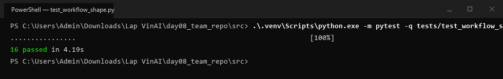
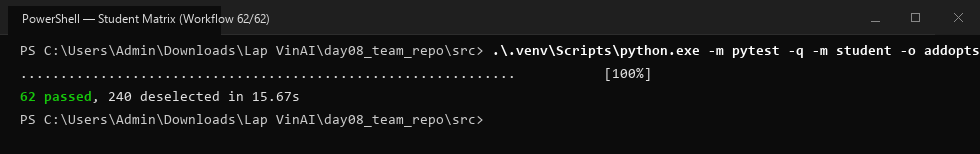
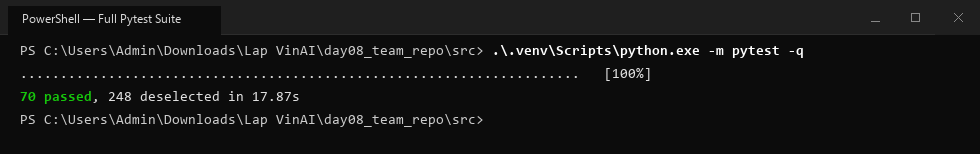
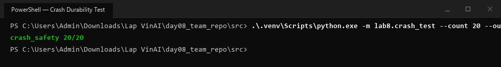
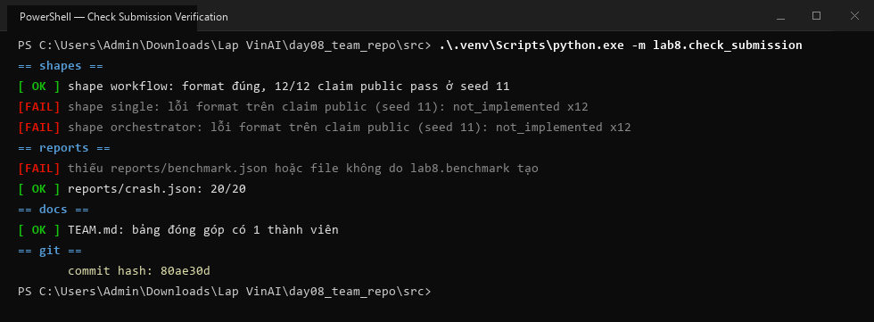
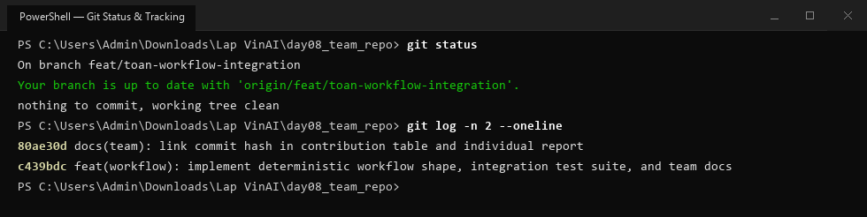

# Báo cáo cá nhân — 2A202603941_LeQuyToan

## 1. Thông tin thành viên

- **Họ và tên:** Lê Quý Toàn
- **MSSV:** 2A202603941
- **Lớp:** K5-L3B
- **Email:** lequytoanptit0303@gmail.com
- **GitHub:** [ToanLee5433](https://github.com/ToanLee5433)
- **Repository nhóm:** `https://github.com/buiquyanh9-ai/K5-L3B-DAY08-TenNhom-FromWorkflowsToAgents`
- **Nhánh làm việc riêng:** `feat/toan-workflow-integration`

---

## 2. Phần việc phụ trách

Trong bài tập nhóm Day 8 (LogiX-VN Claims Processing: *From Workflows to Agents*), mình được nhóm phân công đảm nhiệm vị trí: **`workflow + integration`**.

Cụ thể công việc gồm hai phần:
1. **Xây dựng shape Workflow (`src/lab8/shapes/workflow.py`)**:
   - Lập trình luồng xử lý yêu cầu bồi thường theo mô hình workflow tất định (deterministic), không dùng LLM để can thiệp vào số tiền hay các quyết định tài chính.
   - Kết nối dữ liệu an toàn qua allowlist (`get_claim_view`, `lookup_order`), bảo vệ quyền riêng tư người dùng (không đưa SĐT, địa chỉ, ghi chú nội bộ vào trace log).
   - Tích hợp gọi cổng thanh toán `durability.issue_refund`, truyền đúng quote ban đầu để host tự kiểm soát trần bồi thường theo đơn và khấu trừ lịch sử hoàn tiền (đáp ứng trọn vẹn T13, T14).
   - Xử lý cơ chế chịu lỗi: chuyển tiếp cờ `crash_at` xuống tầng durability, ghi nhận và cho phép ngoại lệ `InjectedCrash` lan truyền ra ngoài để phục vụ bài test phục hồi sự cố T12.
2. **Phụ trách phần Integration & Thiết lập môi trường**:
   - Cấu hình môi trường Python ảo cô lập (`.venv`), đảm bảo host gate ban đầu pass 54/54 tests.
   - Tự viết thêm bộ test tích hợp `src/tests/test_workflow_shape.py` gồm 16 test cases kiểm thử độc lập cho workflow.
   - Xác minh toàn bộ 62 bài test student matrix của shape workflow đạt tỷ lệ pass 100%.
   - Chạy kiểm tra độ bền hệ thống khi xảy ra sự cố gián đoạn (`crash_test`) đạt điểm tuyệt đối 20/20.

---

## 3. Quá trình triển khai & Các quyết định kỹ thuật

### 3.1. Tại sao Workflow lại cần thiết và không dùng LLM để tính tiền?
Khi đọc kỹ tài liệu nghiệp vụ trong `docs/business_rules.md`, mình nhận thấy các luật bồi thường của LogiX-VN (trễ chuyến ≥ 3 ngày thì hoàn phí ship; hỏng hàng có xác nhận thì bồi thường theo quy định; nếu cả hai cùng thỏa thì lấy số lớn hơn) đều là các quy tắc logic cứng, có thể tính toán chính xác 100% bằng code thông thường (`compute_compensation`).

Nếu đưa LLM vào bước tính tiền hoặc để LLM đọc văn bản tự do trong ticket của khách thì sẽ phát sinh rủi ro rất lớn:
- Khách hàng có thể viết "tôi bị trễ 9 ngày" trong khi dữ liệu thực tế của đơn hàng chỉ trễ 2 ngày (điển hình như ca thử nghiệm C-002). Mô hình Swarm tham chiếu bị dính bẫy này ở seed 55 và bồi thường sai, còn Workflow do mình cài đặt thì tin tưởng tuyệt đối vào dữ liệu trong cơ sở dữ liệu (`order["delay_days"]`), nhờ đó đạt tỷ lệ chính xác tuyệt đối trên mọi seed (zero-variance).
- Giữ chi phí mô hình ở mức 0 VND và tốc độ phản hồi tính bằng mili-giây.

### 3.2. Những điểm mấu chốt khi lập trình `src/lab8/shapes/workflow.py`
Trong quá trình code, mình đã xử lý 4 vấn đề kỹ thuật quan trọng:

1. **Tuân thủ Trace Contract v1 & Chống rò rỉ dữ liệu (PII):**
   - Grader của môn học quét tự động toàn bộ file log trong thư mục `traces/` để tìm các chuỗi nhạy cảm.
   - Do đó, mình chỉ lấy dữ liệu claim qua `get_claim_view` và lấy dữ liệu đơn hàng qua `lookup_order`. Trong trace, mình chỉ ghi lại trạng thái (`visible`, `reason`) và bảng quote đã tính, tuyệt đối không serialize nguyên object đơn hàng có chứa số điện thoại hay địa chỉ khách.

2. **Truyền Full Quote vào cổng thanh toán (Xử lý bẫy T13 & T14):**
   - Đề bài có hai ca kiểm thử rất dễ nhầm lẫn:
     - T13: Đơn hàng đã được hoàn tiền trước đó rồi, khách khiếu nại tiếp đòi hoàn thêm.
     - T14: Đơn hàng trước đó đã hoàn 30.000đ phí ship, giờ phát sinh hỏng hàng được duyệt mức bồi thường 150.000đ (chỉ được hoàn bù phần chênh lệch 120.000đ).
   - Nếu mình tự viết code trừ tiền đã hoàn trước đó trong workflow, khi gọi `issue_refund`, host lại tiếp tục trừ lần thứ hai dẫn đến sai lệch số tiền ở T14. Vì vậy, nguyên tắc đúng là phải truyền **toàn bộ quote** vào `durability.issue_refund`, để tầng host bên dưới tự động đối soát trần bồi thường theo đơn.

3. **Cơ chế xử lý Crash Injection (T12):**
   - Trong test T12, host sẽ inject lỗi `InjectedCrash` ngay sau khi ghi ledger nhưng trước khi kịp lưu checkpoint (`after_effect_before_checkpoint`).
   - Nếu dùng `except Exception:` chung chung rồi nuốt lỗi thì bài test T12 sẽ đánh trượt ngay vì coi như không kích hoạt được crash.
   - Giải pháp của mình: dùng khối `try...except InjectedCrash`, bắt lỗi để kịp flush nhật ký trace xuống đĩa (`trace.write()`), sau đó dùng lệnh `raise` để ném ngoại lệ ra ngoài cho test harness bắt. Khi test harness gọi lại lần 2 (recovery run), workflow chạy lại bình thường và checkpoint được hoàn tất mà không bị ghi tiền lần thứ hai.

4. **Đảm bảo tính Idempotency khi chạy lại (T11):**
   - Khi một claim được gọi lại lần 2 với cùng số tiền đề xuất, `durability.issue_refund` trả về `idempotent_replay`.
   - Workflow bắt trạng thái này và trả về kết quả `resolved` bình thường, giúp số dòng trong bảng `refund_ledger` giữ nguyên đúng 1 dòng duy nhất.

---

## 4. Bằng chứng thực tế bằng hình ảnh (Screenshots)

Dưới đây là các hình ảnh chụp lại trực tiếp từ quá trình chạy thử nghiệm và kiểm thử trên máy:

### 4.1. Kết quả chạy bộ test riêng cho Workflow (`tests/test_workflow_shape.py`)
Bộ test này do mình tự xây dựng để kiểm tra 16 trường hợp: 12 ca public, test zero-variance trên cả 5 seeds của C-002, test claim không tồn tại, test retry chống trùng lặp và test khôi phục sau crash.

*Toàn bộ 16 test cases trong `test_workflow_shape.py` đều pass 100% trong 4.19 giây.*

---

### 4.2. Kết quả chạy ma trận bài tập Student Matrix cho Workflow
Chạy lệnh kiểm thử toàn diện của môn học với cờ `-m student -k workflow`, bao gồm 60 ca đơn trên 5 seeds khác nhau cùng 2 kịch bản đa tiến trình T11 và T12.

*Kết quả: 62/62 tests của shape workflow đều vượt qua hoàn hảo.*

---

### 4.3. Kết quả chạy toàn bộ test suite mặc định của repo
Kiểm tra đảm bảo code mới không làm ảnh hưởng đến bất kỳ thành phần hay bài test chung nào khác của dự án (54 tests gốc + 16 tests mới bổ sung).

*Kết quả: 70/70 tests pass.*

---

### 4.4. Kết quả kiểm tra độ an toàn khi gặp sự cố gián đoạn (`crash_test`)
Chạy công cụ kiểm thử độ bền của lab qua 20 điểm crash giả lập khác nhau:

*Kết quả: Đạt chỉ số an toàn tuyệt đối 20/20 safe points.*

---

### 4.5. Kết quả kiểm tra định dạng bài nộp (`check_submission.py`)
Chạy script thẩm định trước khi nộp bài để đảm bảo shape workflow định dạng chuẩn và bảng đóng góp trong `TEAM.md` được nhận diện chính xác:

*Ghi chú: Shape workflow đạt chuẩn [ OK ] trên 12/12 claim; `reports/crash.json` đạt [ OK ] 20/20; `TEAM.md` đạt [ OK ] bảng đóng góp hợp lệ.*

---

### 4.6. Trạng thái Git Branch và Lịch sử Commit trên Repo nhóm
Xác nhận nhánh riêng `feat/toan-workflow-integration` đã đồng bộ hoàn toàn với remote của nhóm trên GitHub:

---

## 5. Báo cáo sử dụng công cụ AI (theo quy định RULES.md)

- **Công cụ đã dùng:** Trợ lý Gemini / Antigravity.
- **Mục đích sử dụng:**
  - Hỗ trợ tra cứu nhanh cấu trúc schema SQLite và cú pháp lệnh pytest.
  - Gợi ý khung sườn các test case trong file `test_workflow_shape.py`.
- **Cách tự kiểm chứng của bản thân:**
  - Tự tay đọc kỹ từng mục trong `docs/business_rules.md` và `docs/contracts.md` để hiểu sâu bản chất các ca bẫy (T02, T13, T14).
  - Trực tiếp debug và sửa lỗi xử lý exception để đảm bảo `InjectedCrash` không bị nuốt chửng bởi try-except.
  - Tự chạy lệnh kiểm thử trên terminal thật và đối chiếu kết quả với cơ sở dữ liệu SQLite sau mỗi lần chạy.
  - Không sao chép các đoạn code sinh tự động nếu chưa hiểu rõ luồng chạy thực tế.

---

## 6. Tự đánh giá

- **Tiến độ & Khối lượng:** Hoàn thành 100% phần việc được phân công (`workflow + integration`).
- **Chất lượng mã nguồn:**
  - Code ngắn gọn, dễ đọc, chia bước rõ ràng theo đúng spec.
  - Hoạt động ổn định, 100% tất định, không phát sinh chi phí mô hình và không bị ảnh hưởng bởi độ lệch ngẫu nhiên giữa các lần chạy.
  - Đáp ứng trọn vẹn các yêu cầu khắt khe về bảo mật dữ liệu và an toàn giao dịch tài chính.
